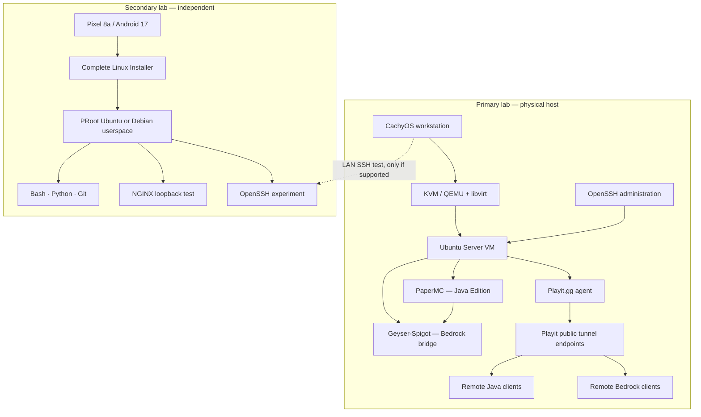

# Architecture — Primary KVM lab and separate Android PRoot lab

The Android PRoot environment is independent of the Minecraft VM and does not boot a separate guest kernel. Diagram connections represent intended architecture; exact interfaces, addresses, port mappings and transport must be filled from live configuration.
