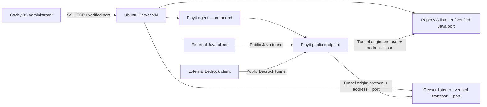

# Network flow — evidence template

## Fill from actual state

| Flow | Protocol | Public endpoint | Local origin | Verified |
|---|---|---|---|---|
| Admin SSH | TBD | Not intended to be public | VM SSH listener | No |
| Java | TBD | Playit dashboard value | Paper listener | No |
| Bedrock | RakNet/UDP or NetherNet TCP+UDP per live config | Playit dashboard value | Geyser listener | No |
| RCON | TCP if enabled; local only | None | Loopback/private | No |

Do not use the diagram as a firewall specification until each value has been inspected and tested.
